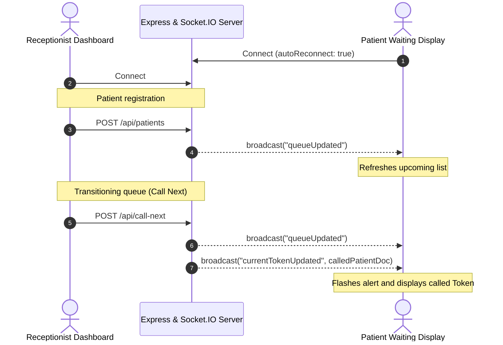

# Queue Cure '26 - Real-Time Clinic Queue Management System

**Queue Cure '26** is a production-ready, real-time clinic queue management system built to solve long wait time uncertainty and manual queue tracking. By replacing paper tokens with a synchronized web interface, receptionists can manage patients seamlessly, and patients in the waiting lobby can view real-time token states, upcoming queues, and estimated wait times on high-visibility displays.

---

## 🚀 Key Features

### Receptionist Dashboard
* **Patient Registration**: Add patient names to the queue (assigns atomic, sequential token numbers starting at `101`).
* **Wait Time Adjustments**: Dynamically set and save the average consultation time in minutes.
* **Queue Board**: View all waiting patients in order of token numbers.
* **Queue Controller**: Call the next patient (moves current serving to completed, and top waiting patient to serving).
* **Sync Indicators**: Real-time server connection status alerts.
* **Toast & Spinners**: Slide-in notification stack, form loaders, and action spinners.

### Patient Waiting Room
* **Giant Token Display**: Large high-visibility token display optimized for waiting lobby TV screens.
* **Personal Token Lookup**: Input tool for patients to query their exact wait time and number of patients ahead of them.
* **Upcoming Queue line**: Display card list showing the next 8 patients in line and their estimated start times.
* **Flashing Shift Alerts**: Visual chime-flashing border ring that triggers on the TV display when a new token is called.

### Real-Time Sync & Resiliency
* **Bidirectional Syncing**: Synchronizes receptionist actions to patient displays instantly using Socket.IO.
* **Auto-Reconnection**: Infinite reconnection retries with exponential backoffs.
* **Duplicate Blocking**: Prevents double patient registrations within the active waiting queue.
* **Stateless Backend**: Server state is persisted in MongoDB Atlas, recovering instantly on restart.

---

## 🛠️ Technology Stack

* **Frontend**: React.js (Vite), Tailwind CSS v4, React Router DOM, Axios, Socket.IO Client
* **Backend**: Node.js, Express.js, Socket.IO, MongoDB Atlas, Mongoose

---

## 📂 Project Structure

```
Queue Cure '26 project/
├── backend/
│   ├── src/
│   │   ├── config/db.js            # MongoDB Mongoose connection
│   │   ├── controllers/
│   │   │   └── queueController.js  # Controller endpoints
│   │   ├── middlewares/
│   │   │   ├── errorHandler.js     # Centralized Express error handler
│   │   │   └── validate.js         # Request payload validator
│   │   ├── models/
│   │   │   ├── Counter.js          # Token sequence collection
│   │   │   ├── ClinicSettings.js   # Clinic config schema
│   │   │   └── Patient.js          # Patient schema & pre-save hook
│   │   ├── routes/
│   │   │   └── queueRoutes.js      # REST API route mappings
│   │   ├── sockets/
│   │   │   └── socketHandler.js    # Socket.IO connection event router
│   │   └── server.js               # bootstraps server & HTTP listeners
│   └── package.json
├── frontend/
│   ├── src/
│   │   ├── services/
│   │   │   ├── api.js              # Axios configuration
│   │   │   └── socket.js           # Socket.IO client configuration
│   │   ├── hooks/
│   │   │   └── useQueueSocket.js   # Custom Socket React Hook manager
│   │   ├── pages/
│   │   │   ├── ReceptionistDashboard.jsx # Dashboard UI
│   │   │   └── PatientWaitingRoom.jsx    # TV waiting lobby UI
│   │   ├── App.jsx                 # Routing configuration
│   │   ├── App.css                 # Blanked styles
│   │   └── index.css               # Tailwind CSS v4 directives & Google Font
│   └── package.json
├── README.md                       # This submission guide
└── thought_process.md              # Document explaining strategies
```

---

## 💻 Installation & Local Setup

### Prerequisites
* [Node.js](https://nodejs.org/) (v18+ recommended)
* A running [MongoDB](https://www.mongodb.com/try/download/community) local instance or a MongoDB Atlas URI

### 1. Backend Setup
1. Navigate to the `backend/` directory:
   ```bash
   cd backend
   ```
2. Install dependencies:
   ```bash
   npm install
   ```
3. Copy the environment variables:
   ```bash
   cp .env.example .env
   ```
4. Set up variables in `.env` (defaults to local fallback `mongodb://localhost:27017/queue_cure_26`).
5. Run the server in development mode:
   ```bash
   npm run dev
   ```
   *Runs on port `5000` by default.*

### 2. Frontend Setup
1. Navigate to the `frontend/` directory:
   ```bash
   cd ../frontend
   ```
2. Install dependencies:
   ```bash
   npm install
   ```
3. Copy the environment variables:
   ```bash
   cp .env.example .env
   ```
4. Run the frontend development server:
   ```bash
   npm run dev
   ```
   *Runs on port `5173` by default.*

---

## 📡 API Reference Documentation

| Method | Endpoint | Payload | Response Example | Description |
| :--- | :--- | :--- | :--- | :--- |
| `POST` | `/api/patients` | `{"patientName": "Ravi"}` | `{"success": true, "tokenNumber": 101}` | Add patient to queue (returns sequence token) |
| `GET` | `/api/patients` | *None* | `[{"patientName": "Ravi", "tokenNumber": 101, "status": "waiting", "estimatedWaitingTime": 0}]` | Get all patients sorted by token number |
| `POST` | `/api/call-next` | *None* | `{"success": true, "calledPatient": {...}}` | Progress queue: completes current, serves next |
| `GET` | `/api/current-token` | *None* | `{"patientName": "Ravi", "tokenNumber": 101, "status": "serving"}` | Get currently serving patient |
| `POST` | `/api/settings` | `{"averageConsultationTime": 15}` | `{"success": true, "settings": {...}}` | Save average consultation time |
| `GET` | `/api/settings` | *None* | `{"averageConsultationTime": 15}` | Get average consultation time |

---

## 🔌 Socket.IO Event Flows

The real-time synchronization layer utilizes two custom events:
* **`queueUpdated`**: Broadcasted when patients are added, called, or settings update, triggering clients to reload data.
* **`currentTokenUpdated`**: Broadcasted when a new token is called, carrying the patient document to trigger the TV flashing chime.



---

## 🌐 Production Deployment Guide

Follow these steps to deploy **Queue Cure '26** to a cloud production hosting provider:

### 1. Database (MongoDB Atlas)
1. Log in to [MongoDB Atlas](https://www.mongodb.com/cloud/atlas) and create a free shared cluster.
2. In **Database Access**, create a database user and password.
3. In **Network Access**, whitelist connection IP addresses (use `0.0.0.0/0` for hosting platforms like Render).
4. Copy the connection string (e.g. `mongodb+srv://<user>:<password>@cluster0.mongodb.net/queue_cure_26?retryWrites=true&w=majority`).

### 2. Backend Deploy (Render / Heroku)
1. Link your GitHub repository to [Render](https://render.com/).
2. Create a new **Web Service**, selecting Node.js as the runtime.
3. Set the **Build Command** to:
   ```bash
   cd backend && npm install
   ```
4. Set the **Start Command** to:
   ```bash
   cd backend && npm start
   ```
5. Add the following **Environment Variables**:
   * `MONGO_URI`: *Your MongoDB Atlas connection string*
   * `CLIENT_URL`: `https://queue-cure.vercel.app` *(Your Vercel/Netlify frontend URL)*
   * `PORT`: `10000` *(Or let Render bind dynamically)*
   * `NODE_ENV`: `production`

### 3. Frontend Deploy (Vercel / Netlify)
1. Link your GitHub repository to [Vercel](https://vercel.com/).
2. Create a new project, setting the **Root Directory** to `frontend`.
3. Select **Vite** as the framework template.
4. Add the following **Environment Variables**:
   * `VITE_API_URL`: `https://queue-cure-backend.onrender.com/api` *(Your deployed backend API URL)*
   * `VITE_SOCKET_URL`: `https://queue-cure-backend.onrender.com` *(Your deployed backend server root URL)*
5. Click **Deploy**. Vercel will automatically compile the bundle and publish your site.
