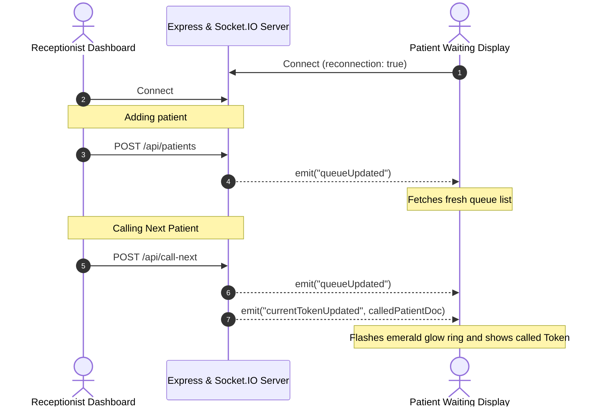

# Queue Cure '26 - Thought Process Document

This document outlines the architectural decisions, strategies, and design patterns utilized in building **Queue Cure '26** for hackathon submission.

---

## 1. Queue Management Strategy

A clinic queue requires absolute order and reliability. We designed a stateless, sequential queue management system in MongoDB using Mongoose:
* **Atomic Token Generation**: Standard MongoDB ID sequences are non-sequential. To assign token numbers like `101`, `102` sequentially without race conditions, we introduced a dedicated `Counter` collection. When saving a new patient, we run an atomic `findOneAndUpdate` increment on the counter.
* **Race-Condition & Reset Resiliency**: If a database is reset or a counter document is deleted, the Patient pre-save hook catches the missing sequence and initializes it back to `101` safely.
* **Active Duplication Prevention**: Patients in a clinic lobby might accidentally double-register. We implemented a case-insensitive check in the service layer. If a patient with the exact name is already in the `'waiting'` queue status, the system rejects the creation with a validation message.
* **FIFO Queue Transitions**: Queue progression follows a strict First-In-First-Out model. When the receptionist calls the next token, the service transitions any active `'serving'` patient to `'completed'`, sorts waiting patients by `tokenNumber` ascending, and transitions the top patient to `'serving'`.

---

## 2. Real-Time Synchronization Strategy

To eliminate page refreshes and keep waiting patients informed, we implemented **Socket.IO**:
* **Stateless Broadcaster**: The backend server broadcasts events to all connected clients globally using `io.emit(...)`.
* **Clean Event Schema**:
  - **`queueUpdated`**: Emitted when a patient is created, transitioned, or settings are changed. This signals clients to pull fresh queue data.
  - **`currentTokenUpdated`**: Emitted when the queue moves forward. It includes the newly called patient's document as a payload, enabling the TV board to render the called token immediately without latency.
* **Resilient Client Hook (`useQueueSocket`)**: Built a custom React hook to manage connection states:
  - **Auto-Reconnection**: Configured infinite reconnect retries and exponential backoff on client handshakes.
  - **Lifecycle Cleanup**: Cleans up socket event listeners on component unmount to prevent memory leaks and duplicate triggers.
  - **Status Indications**: Provides an `isConnected` state, allowing pages to show reactive "Live Sync Connected" or "Offline / Reconnecting" banners.

---

## 3. Wait Time Calculation Logic

Wait times are calculated dynamically based on the clinic configuration and queue position:
* **Wait Time Formula**:
  \[\text{Estimated Waiting Time} = \text{Patients Ahead} \times \text{Average Consultation Time}\]
* **Backend Processing**: The service layer calculates wait times dynamically when fetching patients. For each patient in the `'waiting'` status, it assigns a wait time corresponding to `waitingIndex * averageConsultationTime`.
* **Zero Hardcoding**: Average consultation times are stored in a `ClinicSettings` collection. When settings are updated, a socket broadcast triggers a lobby refresh, recalculating wait times for everyone instantly.

---

## 4. Edge Cases Handled

1. **No Patients In Queue**: Renders a clean **`No Patients Waiting`** label instead of blank tables or broken components.
2. **No Current Token**: Displays **`No Active Consultation`** on TV boards and receptionist dashboards when the doctor is not seeing a patient.
3. **Duplicate Patient Submissions**: Validation checks block concurrent registrations for the same patient in the waiting list.
4. **Rapid Call Next Clicks**: Buttons lock and disable during active fetch queries, preventing API flooding.
5. **Internet Disconnection**: Sockets reconnect automatically, and UI badges alert staff of network status.
6. **Server Restart**: State is fully restored from MongoDB on restart since the API server is stateless.
7. **Invalid Inputs**: Validations return JSON error messages which the client displays as sliding toast alerts.

---

## 5. Socket Event Diagram

The diagram below represents the real-time event flow between components:

---

## 6. Future Improvements

* **SMS/WhatsApp Alert Integration**: Notify patients via text message when their token is 3 positions away, allowing them to wait outside the clinic (e.g., in a cafe) rather than in a crowded lobby.
* **Multi-Doctor support (Multiple consulting rooms)**: Scale the queue system to support multiple doctors/rooms by introducing a `roomNumber` field in `Patient` and routing tokens dynamically.
* **Lobby Voice Announcement (Text-to-Speech)**: Add voice alerts in the waiting lobby (e.g. "Calling Token 102 to consulting room 1") to assist visually impaired patients.
* **Clinic Analytics Reports**: Provide dashboards for clinic administrators to track average wait times, consultation durations, and patient traffic patterns.
